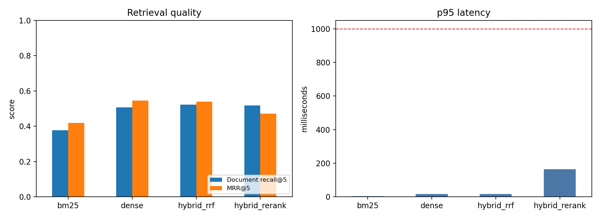

# Salesforce CRM Operations Retrieval Benchmark

Comparison of retrieval configurations (BM25 vs Dense vs Hybrid vs Reranker) on public Salesforce Service Cloud, Sales Cloud, Marketing Cloud, and Developer documentation.

# Why I Picked This Assignment

This project was inspired by my previous experience developing and operating Salesforce-based CRM systems. In practice, quickly finding the right information from large Salesforce documentation was important for both feature development and troubleshooting.

Users do not always search with official terminology; they often describe symptoms or business problems in natural language. This project therefore explores how query rewriting, hybrid retrieval, and reranking can improve CRM documentation search.

# Decisions I Made

## 1. Targeting a CRM Admin Agent

Every query is evaluated from the perspective of a CRM administrator/developer assisting users. The original requester can be a sales, service or marketing user; this is preserved in `requester_role`.

Answers cover configuration, permissions, data models, automation, integration and technical execution conditions. Relevant Apex, Flow and SQL implementation paths are included without requiring Apex when the task explicitly excludes it or the product uses another mechanism. Missing API-level evidence is documented rather than filled with unverified code.

Each query labels only passages that directly explain the core solution, implementation step or stated symptom. Admin/developer context remains available as `supplementary_doc_ids` but receives no evaluation credit. See [the reviewed answers](docs/query_answers.md).

## 2. Varying Query Difficulty

Some queries directly include official Salesforce terminology such as Email-to-Case or Governor Limits.

For harder queries, I described business scenarios and symptoms instead of naming the target feature directly. Examples include situations where an automation fails only for certain users or where a process breaks when handling large volumes of records.

This approach allows the evaluation to measure not only keyword matching performance but also the ability to retrieve relevant documentation from natural language descriptions.

## 3. Using PDF and Official HTML Documentation

I initially considered collecting Salesforce documentation directly from the web.

However, Salesforce's online documentation is spread across many web pages and can be harder to collect consistently due to dynamic navigation, page structure changes, and rendering differences. I initially built the corpus from PDF documentation to make collection reproducible, then expanded it with official Salesforce HTML articles to cover additional implementation and troubleshooting details. The current benchmark searches the combined PDF and HTML corpus. The processed JSONL corpus and cleaned HTML snapshots are checked in so evaluation and HTML chunking can be reproduced without fetching the live pages again.


## Corpus

The current corpus contains **594 retrieval documents**: 354 chunks from 12 Salesforce PDFs and 240 HTML chunks from 24 official article URLs. The original PDF passages are preserved. The HTML manifest contains 25 URLs; the OTT API root was excluded because its referenced schema returned 404.

`src/build_html_corpus.py` downloads static HTML, resolves the public Salesforce Atlas article API, and renders Salesforce Help when necessary. It removes navigation/UI noise, extracts heading-based sections, preserves code and table context, and splits long sections into at most 220 alphanumeric tokens per chunk. New chunks include title, URL, section, document type, parent/section/chunk IDs, fetch time, hashes and source version where available. BM25 and dense use the same combined document list and section context.

Raw HTML caches stay local. Checked-in `html_pages.jsonl` and `html_documents.jsonl` reproduce HTML chunking offline. `src/build_corpus.py` merges the PDF and HTML snapshots. See [the pipeline](docs/html_ingestion.md), [source URLs](data/raw/html_sources.json) and [acquisition report](data/processed/html_ingestion_report.json). Source/API versions can differ across PDFs and current HTML.

# Retrieval Configurations

The benchmark evaluates four configurations on the same documents and queries:

- `bm25`: lexical BM25 retrieval.
- `dense`: dense retrieval with a SentenceTransformers embedding model.
- `hybrid_rrf`: reciprocal-rank-fusion blend of BM25 and dense retrieval.
- `hybrid_rerank`: hybrid RRF candidate generation followed by a CrossEncoder
  reranker over the top 20 candidates.

# Metrics

- Core document recall@5: retrieved core-labelled passages / all core-labelled passages per query.
- Core MRR@5: reciprocal rank of the first core-labelled passage in the returned top 5.
- p95 latency: query-time latency; in the label-only rescore below it is reused from the archived retrieval run.

The 20 queries have 60 core labels. All 594 PDF/HTML chunks remain searchable, including supplementary technical context. Authentication, generic deployment, navigation, broad reference catalogs and unrelated prerequisites are not gold merely because they are useful to an admin.

Core steps and direct alternatives can produce multiple labels. q19 has seven and q20 has six; the mean theoretical recall@5 ceiling is 0.977381. No labels were selected using retrieval rank. The broader answer_aspects metric is not used in the current version.

# Results and Evaluation

## Core-only Labels — 2026-10-23

Rescored archived top-5 retrieval results. Corpus and query strings are identical; original measured latency is reused, not measured again.

The saved rankings are unchanged in 80/80 config-query rows. Changes from the previous broad-label version are not model improvements. [Review and comparison](results/core_evaluation_summary.md), [gold source IDs](data/raw/core_labels.json), [question-by-question answers](docs/query_answers.md).



| config | core recall@5 | core MRR@5 | p95 ms |
| --- | ---: | ---: | ---: |
| bm25 | 0.377 | 0.418 | 3.9 |
| dense | 0.507 | 0.546 | 16.0 |
| hybrid_rrf | 0.522 | 0.539 | 17.1 |
| hybrid_rerank | 0.518 | 0.471 | 164.3 |

With MRR prioritized, `dense` is the preferred configuration under this policy. This is a descriptive result on 20 questions, not a statistical significance claim or generated-answer evaluation.

## Category Analysis

Mean core document recall@5:

| category | bm25 | dense | hybrid_rrf | hybrid_rerank |
| --- | ---: | ---: | ---: | ---: |
| `natural_language_task_description` | 0.612 | 0.619 | 0.655 | 0.643 |
| `exact_product_feature_lookup` | 0.408 | 0.633 | 0.558 | 0.592 |
| `paraphrased_feature_discovery` | 0.125 | 0.458 | 0.458 | 0.458 |
| `symptom_based_troubleshooting` | 0.103 | 0.056 | 0.225 | 0.159 |

## Hard Queries

| config | hard core recall@5 | hard core MRR@5 | complete misses |
| --- | ---: | ---: | --- |
| bm25 | 0.102 | 0.290 | q16, q17 |
| dense | 0.200 | 0.500 | q12, q19 |
| hybrid_rrf | 0.262 | 0.307 | q12 |
| hybrid_rerank | 0.162 | 0.317 | q12, q17 |

Some questions need multiple core passages and retain scope limitations. In particular, related-record update concepts do not constitute a complete tested Case-to-Account implementation. Technical supporting pages remain available for an admin agent, but retrieving them alone is not counted as a core answer.

# If I Had One More Week

If I had one more week, I would improve the corpus construction, the evaluation set, and the retrieval pipeline.

For corpus construction, I would improve the context and structure retained from PDFs. The current retrieval input already includes each chunk's title, product area, and section where available. HTML chunks also retain heading-based sections, code and table context, and parent document metadata. PDF chunks still have less structural context, even though Salesforce guides often depend on section hierarchies, tables, setup steps, diagrams, and screenshots. I would therefore extract richer section hierarchies and parent document metadata from PDFs, preserve table and step-by-step structures more faithfully, and generate short descriptions for visual content. This could help distinguish chunks containing terms such as `routing address`, `debug options`, or `field permissions` across Email-to-Case, Flow Debug, and Field-Level Security documentation. I would also test grouping results from the same page or section.

For evaluation, I would expand the 20-query benchmark, especially in the hardest categories: symptom-based troubleshooting and paraphrased feature discovery. I would also add more natural-language automation cases to test whether dense retrieval can consistently handle broad, goal-oriented user phrasing.

I would also tune the hybrid retrieval and reranking pipeline rather than assuming the current hybrid settings are optimal. The current results show that hybrid methods recovered different hard cases from dense retrieval, so better weighting, candidate depth, or reranker calibration might improve robustness on difficult queries.

Finally, I would inspect hard misses to see whether they are caused by poor chunk boundaries, missing section context, ambiguous labels, or model limitations. This would make the benchmark more representative of real Salesforce documentation search, where users often describe their goal or problem without knowing the exact Salesforce feature name.


# Reproduce

Install dependencies:

```bash
pip install -r requirements.txt
```

Reproduce the reported benchmark results from the checked-in processed corpus:

```bash
make run
```

If `make` is not available on Windows, use the equivalent PowerShell command:

```powershell
powershell -ExecutionPolicy Bypass -File scripts/run.ps1
```

Both commands write `results/metrics.csv`, `results/per_query_results.csv`, and
`results/metrics_plot.png`.

To rebuild the processed corpus from the raw source list before evaluation, the
local PDF references in `data/raw/source_urls.txt` must also be available on the
machine, or replaced with equivalent public PDF URLs. Then run:

```bash
make build-corpus
make inspect
make run
```
